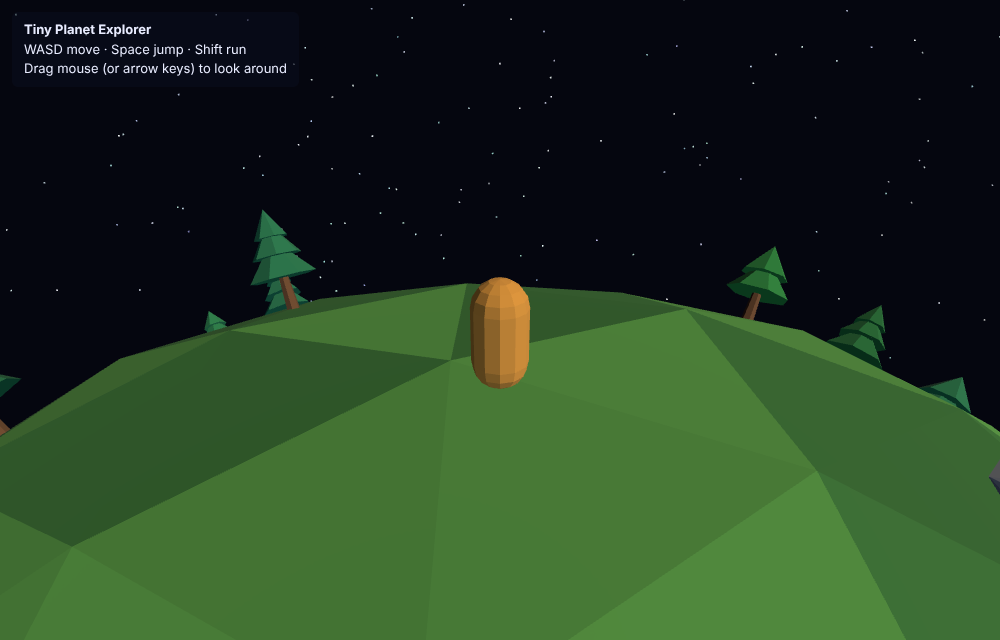

# Tiny Planet Explorer

A small Three.js + Vite game: walk around a low-poly planet with spherical gravity.



```sh
npm install
npm run dev      # open the printed localhost URL
npm run build    # production build in dist/
```

Controls: WASD to move (relative to the camera), Space to jump, Shift to run,
drag the mouse or use the arrow keys to orbit the camera.

## Code layout

- `src/planet.js`: displaced icosphere terrain, scattered trees and rocks, `surfaceRadius(dir)` ground query
- `src/player.js`: capsule, camera-relative tangent-plane movement, jump, spherical gravity, obstacle push-out
- `src/camera.js`: third-person follow camera with up aligned to the surface normal and slerped orientation
- `src/sky.js`: star field; `src/input.js`: keyboard and mouse; `src/main.js`: scene setup and loop
